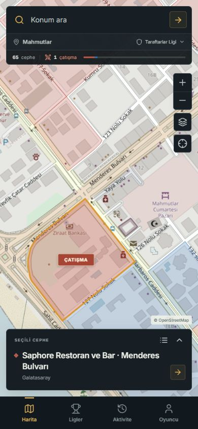
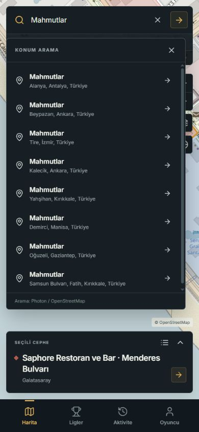

[](README.tr.md)

# Cepheland

**Choose your side. Claim your front.**

Cepheland is a location-based territory strategy game built around real city streets. Players join a team within a league, explore a shared map, contribute to conflicts and compete for control of small geographic areas called **fronts**. Each season keeps its own team membership, territory state and rankings.

This repository contains the mobile web player application, REST API, administration panel, project showcase and shared game and geospatial packages. The opening scenario is in Mahmutlar, Alanya, Türkiye. Place search also accepts other neighborhoods, cities and addresses; exploration is not limited to a list of preset regions.

**The current implementation is a local development and product demonstration environment.** Game state is held in memory, and authentication, location submission and device integrity contain demonstration behavior. The repository is not a ready-to-deploy public game backend. The [implementation boundaries](#implementation-boundaries) below describe what works today and what remains necessary for a live service.

| Player map | Place search |
| --- | --- |
|  |  |

Screens from the player application. Ownership, conflict counts and scores vary with the running demonstration session.

## Contents

- [Game model](#game-model)
- [Player experience](#player-experience)
- [Roads, parcels and place names](#roads-parcels-and-place-names)
- [Architecture](#architecture)
- [Getting started](#getting-started)
- [Configuration](#configuration)
- [Working with the API](#working-with-the-api)
- [Verification and CI](#verification-and-ci)
- [Preparing map data](#preparing-map-data)
- [Implementation boundaries](#implementation-boundaries)
- [Troubleshooting](#troubleshooting)
- [Contributing](#contributing)
- [Data sources and usage rights](#data-sources-and-usage-rights)

## Game model

A **league** defines a competition and its participating teams. A **season** gives that competition a period of play and an independent ownership map. A player chooses one team for that season; changing sides during the season is blocked by the membership rules.

A **front** is a selectable polygon on the map. It can be neutral, owned by a team, contested, protected or temporarily unavailable for play. A **battle** evaluates approved player contributions for control of that front. A **play zone** supplies the geometry used to check whether a submitted location sample belongs to the relevant area.

The normal player journey is:

1. Open the map or search for a place.
2. Select a league and join one of its season's teams.
3. Select a front and inspect its name, ownership and active battle.
4. Request a time-limited contribution challenge and submit a contribution with a unique operation key.
5. Check the battle result and review personal contributions in Activity.

The rule engine is separate from the interface. It evaluates contribution quotas, duplicate participation, minimum participation thresholds, ties, protection periods, cooldowns and ranking calculations. The demonstration rules allow contributions to at most three distinct fronts per day in a season. An attacker needs the minimum number of qualifying participants and more approved support than the defender. A tie preserves the defending team; a tied contest for a neutral front leaves it neutral.

Rankings distinguish **front count**, **approved unique-player support** and **weighted territory control**. These measures describe different aspects of the competition. Holding more fronts does not necessarily mean attracting more players or leading the weighted ranking. Rules and their tests are in [`packages/game-rules`](packages/game-rules).

## Player experience

`apps/mobile` is a responsive **React web application**, built with Vite and Leaflet. This repository does not currently include a distributable Android or iOS application.

| Area | Available behavior |
| --- | --- |
| Map | Street and satellite layers, zoom controls, front selection and a collapsible detail panel. |
| Place search | Submitted text queries for neighborhoods, cities and addresses, with district, region and country information to distinguish similarly named places. |
| Team indicator | A compact team name and color indicator in the map header, resolved from the active season's membership. |
| Leagues | League selection, season teams, membership display and joining a team. |
| Activity | The authenticated player's recent contributions for the selected season and remaining daily front allowance. |
| Player | Profile information and the current demonstration account controls. |
| Battle | The selected front's name, team scores and battle state. |

The interface uses Turkish product copy. Some records include localized fields, but the complete player experience has not been translated into English.

The quick map entry uses the seeded `ahmet_gs` account. The sign-in screen also offers demonstration accounts. The fixed verification code is `123456`; no real SMS or email verification takes place.

| Demonstration account | Seeded team |
| --- | --- |
| `ahmet_gs` | Galatasaray |
| `mehmet_fb` | Fenerbahçe |
| `ayse_bjk` | Beşiktaş |

The initial scenario and sample profiles are defined in [`apps/api/src/db/store.ts`](apps/api/src/db/store.ts). Use these fixtures rather than real personal information when evaluating the application.

## Roads, parcels and place names

### Deriving fronts from roads

The active map pipeline reads OpenStreetMap road geometry in fixed geographic tiles. Road segments are split at intersections, closed street blocks are polygonized, and road corridors, water areas and the sea side of coastlines are removed from playable land. Land outside closed road blocks is divided into irregular, deterministically seeded Voronoi parcels.

The result combines two behaviors: streets define the boundaries of closed urban blocks, while open land receives repeatable, random-looking subdivisions. The same source version and location produce the same front identity. Panning the map or enriching a name does not reallocate ownership.

These are **game territories, not cadastral or legal land parcels**. OSM generally provides road centerlines. Road width is estimated from an explicit width tag, lane count or road classification. Open land means land outside the detected closed road blocks; it is not a verified classification of vacant property. Missing roads, old source data and blocks larger than the processing margin can affect the result.

### Naming fronts

The naming resolver considers named businesses, buildings and other places inside the parcel, followed by named streets along its boundary. Typical names use `place · street` or `street / second street`. Duplicate candidates are distinguished with additional real place information where possible and a short stable suffix when necessary.

A business across the street, outside the parcel, or inside an excluded water or road ring does not qualify simply because it is nearby. When no suitable real name is available, the system uses a location-based unnamed-land label rather than inventing a business or street.

Assigned names and historical aliases are kept in a separate persistent registry. Better place data can enrich a name later; a temporary provider outage does not downgrade an already assigned name. Front IDs, geometry and game state remain independent of their display names. Historical OSM business records do not confirm that a business is still operating.

### Progressive map loading

Interactive clients request `/maps/viewport` with `progressive=1`. The API returns ready fronts immediately and reports the progress of missing tiles separately. Road downloads and expensive geometry work continue in bounded background queues. A failed neighboring tile does not remove ready fronts from the screen.

- Requests for the same tile share work rather than starting duplicate downloads or calculations.
- The client rejects stale responses when the viewport changes and cancels obsolete requests.
- At distant zoom levels, the interface asks the player to zoom in instead of downloading a large parcel area.
- A request can cover at most 16 source tiles. Larger requests receive `VIEWPORT_TOO_LARGE`.
- Mobile progress polling stops after a bounded period, currently 60 seconds, and provides a retry path.
- Explicit place searches have an eight-second total budget including queue time. Successful search results are cached for 24 hours.

The repository includes **12 prepared opening-area tiles** around Mahmutlar, Moda, central Konya and central Ankara. Their road and water data, calculated parcels and naming candidates are available locally. This is a limited opening-area bundle, not complete coverage of those cities or the world. Outside the bundle, availability and loading time depend on the configured external services. Missing road data is not replaced with a fabricated urban street network.

See the [road parcel guide](docs/road-parcels.md) for algorithm details, geometry versions, naming rules and accuracy limits.

## Architecture

Cepheland uses a TypeScript monorepo managed with pnpm workspaces and Turborepo. Browser applications communicate with the API over HTTP. Shared packages hold game rules, geospatial operations, contracts and design values.

| Workspace | Responsibility | Main technology |
| --- | --- | --- |
| `apps/api` | Authentication, leagues, fronts, contributions, battles, rankings and administrative endpoints. | Express, TypeScript |
| `apps/mobile` | Player interface designed for mobile screens. | React, Vite, Leaflet |
| `apps/admin` | League and territory tools, battle controls and review screens. | React, Vite, Leaflet |
| `apps/showcase` | Project and scenario presentation interface. | React, Vite |
| `apps/worker` | Scheduler scaffold for future background jobs. | Node.js, TypeScript |
| `packages/contracts` | Shared data contracts and validation schemas. | TypeScript, Zod |
| `packages/game-rules` | Winner selection, quotas, state transitions and ranking calculations. | TypeScript |
| `packages/geo` | Road partitioning, geometric operations, naming and location checks. | Turf, GeoJSON, TypeScript |
| `packages/ui-tokens` | Shared colors, typography and theme values. | TypeScript |
| `packages/config` | Shared compiler configuration. | TypeScript configuration |

```text
Cepheland/
├── apps/
│   ├── api/
│   │   ├── data/          # Read-only prepared opening maps
│   │   ├── src/           # Routes, services and demonstration store
│   │   └── test/          # API and service integration tests
│   ├── mobile/
│   ├── admin/
│   ├── showcase/
│   └── worker/
├── packages/
│   ├── contracts/
│   ├── game-rules/
│   ├── geo/
│   ├── ui-tokens/
│   └── config/
├── infrastructure/
│   ├── compose.yml       # Optional local data services
│   └── sql/              # Schemas and SQL fixtures
├── docs/
├── .github/workflows/ci.yml
├── README.md
└── README.tr.md
```

The running API uses the in-memory `dbStore`. PostgreSQL/PostGIS schemas and Redis/MinIO service definitions are included as development material, but starting those services does not connect them to the API. The worker's periodic settlement, expiration and evidence-purge methods are scaffolding, not implemented background jobs.

## Getting started

### Requirements

- Node.js 22 or later.
- pnpm matching the root `packageManager` entry: `pnpm@12.14.0` for this revision.
- Git.
- Internet access for the initial dependency installation, map tiles and online place search.

Docker is optional. The API and mobile web application are sufficient to explore the game demonstration.

### Clone, install and build

```bash
git clone https://github.com/ersinsandal/Cepheland.git
cd Cepheland
npm install --global pnpm@12.14.0
pnpm install --frozen-lockfile
pnpm build
```

Skip the global installation command if the required pnpm version is already installed. Build once before starting individual applications: workspace packages expose their generated `dist` modules to the applications that consume them.

Start the API in one terminal:

```bash
pnpm dev:api
```

Start the player application in another:

```bash
pnpm dev:mobile
```

Open [http://localhost:3002](http://localhost:3002), select **Haritaya gir**, and explore Mahmutlar. Submit a place name in the search field to inspect results and move the map to another location.

| Component | Command | Default address |
| --- | --- | --- |
| API | `pnpm dev:api` | `http://localhost:3001` |
| Player application | `pnpm dev:mobile` | `http://localhost:3002` |
| Administration panel | `pnpm dev:admin` | `http://localhost:3010` |
| Showcase | `pnpm dev:showcase` | `http://localhost:4000` |
| Worker scaffold | `pnpm dev:worker` | No HTTP interface |

`pnpm dev:all` starts workspace development processes in parallel. Starting only the API and player application uses fewer resources when evaluating the game. Keep these development services on a trusted machine or local network.

On Windows, if PowerShell blocks `pnpm.ps1`, use the command shim:

```powershell
pnpm.cmd install --frozen-lockfile
pnpm.cmd build
pnpm.cmd dev:api
```

[`start-platform.ps1`](start-platform.ps1) is a Windows convenience launcher. It builds the workspace, checks unit and integration tests, stops on a failure, and then starts all development services.

### Optional infrastructure

To inspect the database schema and other planned data services:

```bash
docker compose -f infrastructure/compose.yml up -d
```

Compose binds PostgreSQL to port `5432`, Redis to `6379`, MinIO to `9000`, and the MinIO console to `9001` on the local machine. Database initialization mounts the SQL migration directory. These containers are not required by the current in-memory game API. Their development credentials are not deployment credentials.

## Configuration

[`.env.example`](.env.example) lists the settings used by the current runtime. The basic demonstration starts with development defaults. Optional API configuration belongs in `apps/api/.env` because the filtered API command runs from that package directory:

```bash
cp .env.example apps/api/.env
```

On PowerShell, use `Copy-Item .env.example apps/api/.env`. Replace the example `JWT_SECRET` with a locally generated value. For example, `node -e "console.log(require('node:crypto').randomBytes(32).toString('hex'))"` prints a random value that can be copied into the local file. Do not commit the resulting environment file or signing key.

Mobile Vite configuration belongs in `apps/mobile/.env.local`. Values beginning with `VITE_` are included in the client bundle and must not contain secrets.

| Variable | Purpose |
| --- | --- |
| `PORT` | API listening port; defaults to `3001`. |
| `NODE_ENV` | Runtime environment; tests use it to suppress the listener and some disk writes. |
| `JWT_SECRET` | API session signing key. The development fallback is unsuitable for a live service. |
| `OSM_OVERPASS_URLS` | Comma-separated Overpass-compatible endpoints. |
| `OSM_CACHE_DIR` | Writable cache for pinned source road and place data. |
| `PARCEL_CACHE_DIR` | Writable cache for calculated parcel geometry. |
| `FRONT_NAMES_FILE` | Persistent registry of unique assigned front names and aliases. |
| `PLACE_SEARCH_URL` | Replaceable Photon-compatible place-search endpoint. |
| `VITE_API_BASE_URL` | Player application's API address; defaults to `http://<browser-hostname>:3001`. |

For a different mobile API address, add this to `apps/mobile/.env.local` and restart Vite:

```dotenv
VITE_API_BASE_URL=http://localhost:3001
```

Relative custom cache paths are resolved from the API process working directory. Leave optional provider and path settings unset to use their defaults. Environment variables configure existing components; they do not enable a persistent database, real message delivery or device-attestation verification. There is no configuration switch that makes the demonstration authentication production-ready.

### Data stored on disk

| Location | Contents |
| --- | --- |
| `apps/api/data/` | Versioned opening-area bundle; no player ownership records. |
| `apps/api/scratch/osm-cache/v1/` | Source roads and place data downloaded during use. |
| `apps/api/scratch/parcel-cache/` | Geometry results keyed by their input content. |
| `apps/api/scratch/name-candidates/` | Prepared naming proposals for geometry and place data. |
| `apps/api/scratch/front-names/v1.json` | Persistent assigned names and historical aliases. |

Scratch directories are excluded from Git. Geographic persistence and game-state persistence are different concerns: a restart can retain source maps and names while losing contributions and ownership changes held in memory. A durable game service also needs a migration plan for geographic versions and front IDs.

## Working with the API

The health endpoint and public read routes can be inspected directly:

```bash
curl "http://localhost:3001/health/public"
curl "http://localhost:3001/leagues"
curl "http://localhost:3001/maps/places?q=Mahmutlar"
```

A progressive viewport query for the opening area:

```bash
curl "http://localhost:3001/maps/viewport?progressive=1&season_id=e0000000-0000-0000-0000-000000000001&minLat=36.4854&maxLat=36.4914&minLng=32.0925&maxLng=32.1005"
```

The response contains `fronts`, `seasonId`, `serverTime` and `loading`. Loading status can be `ready`, `loading`, `partial` or `unavailable`. Tile counts describe completed, pending and failed work; `retryAfterMs` gives retry guidance. HTTP 200 on a progressive request does not mean every tile is ready. Clients must inspect the loading fields as well as the fronts.

| Method and path | Purpose | Player session |
| --- | --- | --- |
| `GET /health/public` | Process health. | Not required |
| `POST /auth/start` | Start the demonstration OTP flow. | Not required |
| `POST /auth/verify` | Verify the demonstration code and issue tokens. | Not required |
| `GET /leagues` | Leagues, teams and active seasons. | Not required |
| `GET /seasons/:id/me` | Current user's membership in a season. | Required |
| `POST /seasons/:id/join` | Join a season team. | Required |
| `GET /maps/places?q=...` | Free-text place search. | Not required |
| `GET /maps/viewport` | Fronts intersecting a viewport. | Not required |
| `GET /fronts/:id` | Front and play-zone details. | Not required |
| `GET /claims/eligibility` | Contribution eligibility and remaining allowance. | Required |
| `POST /claims/challenge` | Create a time-limited contribution challenge. | Required |
| `POST /claims` | Submit a contribution and location samples. | Required |
| `GET /battles/:id` | Battle state and scores. | Not required |
| `GET /rankings` | Calculated rankings. | Not required |
| `GET /me/activity?season_id=...` | User- and season-scoped recent activity. | Required |

Authenticated requests use `Authorization: Bearer <accessToken>`. For local API exploration, a token can be obtained with a demonstration account:

```bash
curl -X POST "http://localhost:3001/auth/verify" \
  -H "Content-Type: application/json" \
  -d '{"identifier":"ahmet_gs","code":"123456"}'
```

A contribution first checks eligibility, requests a challenge, and submits `challengeId`, `idempotencyKey`, `locationSamples` and `integrity`. The demonstration mobile client supplies a simulated location at the front center. This is not evidence of physical presence.

The current route implementations are in [`apps/api/src/index.ts`](apps/api/src/index.ts); shared schemas are in [`packages/contracts`](packages/contracts). Administrative endpoints are deliberately omitted from the player reference above: they are local demonstration tools, and their authorization is not complete.

## Verification and CI

Run the following from the repository root:

```bash
pnpm build
pnpm typecheck
pnpm test:unit
pnpm test:integration
```

`pnpm test` runs Turborepo's package `test` tasks. API integration tests have a separate script and must also be run with `pnpm test:integration`. A successful build checks TypeScript compilation and production bundling; it does not verify live provider availability or establish production security.

The suites cover game outcomes and quotas, road intersections and dead ends, coastlines and water holes, deterministic open-land coverage, neighboring parcels, identity preservation across viewports and seasons, unique names, progressive responses, request deduplication, provider failures, place-search deadlines and activity access scope. Startup tests verify restored names and environment configuration ordering.

Integration tests use controlled geographic inputs and provider responses rather than repeatedly downloading live OSM data. UI changes also require browser checks at mobile widths, including place search, league selection and front details. A standalone automated browser end-to-end suite is not yet included.

[GitHub Actions](.github/workflows/ci.yml) runs a frozen dependency installation, the workspace build, unit tests and API integration tests on Ubuntu with Node.js 22. The workflow runs for pushes to `main`, pull requests and manual dispatch. Its actions are pinned to commit revisions and its repository permissions are read-only.

## Preparing map data

The opening bundle is committed, so a normal installation does not need to download it again. The preparation tool is intended for the explicitly configured small opening areas:

```bash
pnpm --filter @cepheland/api maps:prepare
pnpm --filter @cepheland/api maps:prepare mahmutlar
```

Supported area keys are `mahmutlar`, `moda`, `konya` and `ankara`. The tool preserves pinned source files, prepares missing data, calculates geometry and naming candidates, and writes a preparation report. Updating an existing source tile requires deliberate treatment of its data version and the front identities derived from it.

Preparation does not run inside an interactive viewport request. Wider coverage should use regional OSM extracts or a dedicated query service. The OSM editing API is not a bulk world-download backend for the game. Bundle layout, source attribution and coverage are documented in [`apps/api/data/README.md`](apps/api/data/README.md).

## Implementation boundaries

The distinction between an implemented screen and a completed production integration is part of the project's current scope.

| Area | Current implementation | Work needed for a live service |
| --- | --- | --- |
| Game storage | In-memory collections seeded at startup. | Durable storage, transactions, concurrency control and backups. |
| Authentication | Fixed demonstration OTP and development JWT behavior. | Real verification, session lifecycle and abuse controls. |
| Location | The web demo submits the selected front's center. | Device permission flow, real samples and server-side evidence checks. |
| Device integrity | Demonstration fields and sample risk branches. | Verified Play Integrity/App Attest integrations. |
| Administration | Operational screens and demonstration mutations. | Consistent authentication, role authorization and access restrictions. |
| Background jobs | Scheduler shell with unimplemented job methods. | Durable queues, battle settlement, expiration and evidence cleanup. |
| Map providers | Public services, prepared areas and local caches. | Provider capacity suitable for the intended traffic. |
| Account privacy controls | Demonstration export and in-memory anonymization routes. | Complete data handling, token invalidation and retention behavior. |
| Brand and legal work | Design and review notes. | Deployment-specific review and applicable permissions. |

The application does not continuously track background GPS in its current web interface. That fact does not imply that all privacy, deletion, integrity or auditing requirements have been implemented. Read [`SECURITY.md`](SECURITY.md) for the actual security boundaries and [`PRIVACY.md`](PRIVACY.md) for the demonstration's data handling.

The [product specification](CEPHELAND_MASTER_BLUEPRINT.md) and [decision log](DECISIONS.md) also describe intended future behavior. They are design references, not a declaration that every listed capability is present in the running code.

## Troubleshooting

| Symptom | What to check |
| --- | --- |
| A workspace package or `dist` module cannot be found. | Run `pnpm install --frozen-lockfile`, then `pnpm build` from the root. |
| PowerShell blocks `pnpm.ps1`. | Use `pnpm.cmd` for the same command. |
| The player page opens but the API does not respond. | Check `http://localhost:3001/health/public` and the API terminal. Match the mobile API address to any custom port. |
| Map tiles appear without fronts. | Zoom to street level. Outside the prepared bundle, road data or geometry may still be loading. |
| Place search only returns recorded local places. | The online provider may be unavailable; the search panel reports when local fallback is used. |
| Road data cannot be obtained. | Retry after the indicated cooldown or configure another Overpass-compatible provider. |
| Contributions disappear after restarting the API. | The game store is in memory. Geographic caches do not persist game state. |
| A phone can load the page but cannot reach the API. | Use the development machine's reachable address and port; configure `VITE_API_BASE_URL` if needed. Limit access to a trusted local network. |
| An environment variable appears ineffective. | Put it in the correct application's environment file and restart the process. Vite values are applied when the client is built. |

## Contributing

Keep changes within the relevant workspace and explain the behavior being changed. Geometry and naming changes can affect front identity, ownership references and cache compatibility; document those effects before changing a source or engine version.

For map issues, include the area, zoom level, expected boundary and observed result. Do not attach personal location history or real player records. For a contribution:

1. Describe the problem and expected result.
2. Run the relevant build and tests.
3. Update both README files and detailed documentation when behavior, APIs or configuration change.
4. Include a mobile screenshot for interface changes.
5. Write commit messages in English and record how the change was verified.

Do not commit dependencies, build outputs, local environment files, credentials, runtime caches or personal test data. New geographic bundles should include their source, preparation method, coverage and attribution. Report security-sensitive issues according to [`SECURITY.md`](SECURITY.md).

## Data sources and usage rights

Road, coastline, water and place data is **© OpenStreetMap contributors**. OSM-derived datasets are subject to [OpenStreetMap attribution requirements](https://www.openstreetmap.org/copyright) and the [Open Database License (ODbL) 1.0](https://opendatacommons.org/licenses/odbl/1-0/). This database license is separate from the application's source code.

Place search uses a Photon-compatible service. The street layer uses OpenStreetMap tiles, and the optional satellite layer uses Esri imagery. Keep provider attribution visible. Open geographic data does not imply unlimited capacity or uninterrupted access to a public tile or query service.

No general source-code license has been selected for this revision. Public visibility alone does not grant a general reuse or redistribution license. Dependencies and data sources retain their own terms. Club, platform and business names used in examples do not imply sponsorship, endorsement or an operating partnership. See [`THIRD_PARTY_NOTICES.md`](THIRD_PARTY_NOTICES.md) for the data and service notices.

Maintained by [Ersin Sandal](https://github.com/ersinsandal). Repository: [ersinsandal/Cepheland](https://github.com/ersinsandal/Cepheland).
