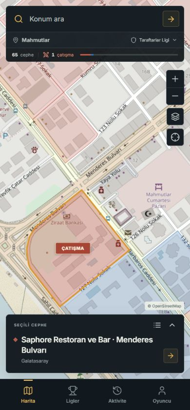
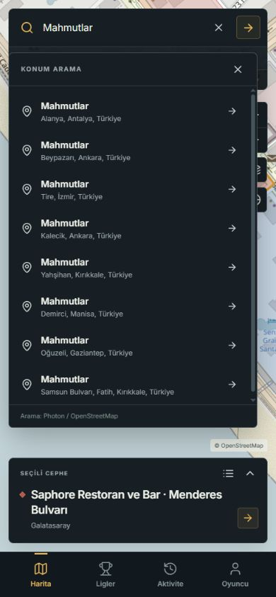

# Cepheland

[](README.md)

**Tarafını seç. Cepheni kazan.**

Cepheland, gerçek şehir haritalarındaki sanal bölgelerin kontrolü için takımların yarıştığı, konum temelli bir strateji oyununun geliştirme deposudur. Oyuncular bir lige ve o ligin sezonundaki bir takıma katılır; sokakların çevrelediği cepheleri keşfeder, çatışmalara katkı verir ve takımının haritadaki durumunu takip eder.

Depo; mobil kullanıma göre tasarlanmış web uygulamasını, REST API'yi, yönetim panelini, sunum uygulamasını ve ortak oyun/coğrafya paketlerini birlikte içerir. Başlangıç senaryosu Alanya'nın Mahmutlar mahallesindedir. Harita araması belirli bir şehir listesiyle sınırlı değildir; mahalle, şehir veya adres yazarak başka konumlara gidilebilir.

**Mevcut sürüm, yerel geliştirme ve ürün demonstrasyonu içindir.** Oyuncu ve savaş verileri bellek içinde tutulur. Kimlik doğrulama, konum gönderimi ve cihaz bütünlüğü akışlarında demo davranışları bulunur; yönetici uçları üretim ortamına uygun yetkilendirmeyle korunmuş değildir. Kaynak kodun herkese açık olması, uygulamanın genel internete açık bir oyun sunucusu olarak çalıştırılmaya hazır olduğu anlamına gelmez. Ayrıntılar [mevcut sınırlar](#mevcut-sınırlar-ve-üretim-ortamına-geçiş) bölümündedir.

| Mobil harita | Konum araması |
| --- | --- |
|  |  |

Oyuncu uygulamasından örnek ekranlar. Haritadaki sahiplik, çatışma sayısı ve skorlar çalışan demo oturumuna göre değişebilir.

## İçindekiler

- [Oyun modeli](#oyun-modeli)
- [Oyuncu uygulaması](#oyuncu-uygulaması)
- [Harita, parseller ve cephe adları](#harita-parseller-ve-cephe-adları)
- [Mimari ve depo düzeni](#mimari-ve-depo-düzeni)
- [Kurulum](#kurulum)
- [Yapılandırma](#yapılandırma)
- [API ile çalışma](#api-ile-çalışma)
- [Test ve doğrulama](#test-ve-doğrulama)
- [Harita verisini hazırlama](#harita-verisini-hazırlama)
- [Mevcut sınırlar ve üretim ortamına geçiş](#mevcut-sınırlar-ve-üretim-ortamına-geçiş)
- [Sorun giderme](#sorun-giderme)
- [Geliştirmeye katkı](#geliştirmeye-katkı)
- [Veri kaynakları ve kullanım hakları](#veri-kaynakları-ve-kullanım-hakları)

## Oyun modeli

Oyun dünyası **lig**, **sezon**, **takım**, **cephe** ve **savaş** kavramları üzerine kuruludur.

| Kavram | İşlevi |
| --- | --- |
| Lig | Aynı rekabet konusunu paylaşan takımları bir araya getirir. Örnek veride Taraftarlar Ligi ve Oyun Konsolları Ligi bulunur. |
| Sezon | Takım üyeliğini, cephe sahipliğini, katkıları ve sıralamayı belirli bir oyun döneminde tutar. |
| Takım | Oyuncunun ilgili sezonda katkı verdiği taraftır. Bir sezona katıldıktan sonra takım değiştirmek engellenir. |
| Cephe | Haritada seçilebilen sanal oyun alanıdır. Sınırı bir çokgenle temsil edilir; bir takımın kontrolünde veya tarafsız olabilir. |
| Savaş | Bir cephenin kontrolünün, onaylanan tekil oyuncu katkıları üzerinden değerlendirildiği süreçtir. |
| Katılım alanı | Konum örneğinin cepheye ait kabul edilip edilmeyeceğinin denetlendiği geometridir. Yol ve su boşlukları ayrıca ele alınır. |

Bir oyuncunun temel akışı şöyledir:

1. Haritayı açar veya bir konum arar.
2. Oynamak istediği ligi seçer ve sezonun takımlarından birine katılır.
3. Bir cepheyi seçerek adını, kontrol durumunu ve varsa devam eden savaşını görür.
4. Katkı isteği için sunucudan süreli bir challenge alır; isteği benzersiz bir işlem anahtarıyla gönderir.
5. Sonucu savaş ekranından, günlük hareketlerini Aktivite ekranından takip eder.

Oyun kuralları, arayüzden ayrı olarak [`packages/game-rules`](packages/game-rules) içinde tutulur. Mevcut hesaplamalar günlük farklı cephe kotasını, aynı savaşa mükerrer katkıyı, asgari katılımcı eşiğini, eşitlik durumlarını, koruma süresini ve saldırı bekleme süresini ele alır. Örnek kurallarda günlük kota üç farklı cephedir. Saldıran tarafın kazanması için asgari katılım eşiğini geçmesi ve savunan taraftan fazla onaylı katkı toplaması gerekir; eşitlikte savunan taraf korunur. Tarafsız cephede birincilik eşitse cephe tarafsız kalır.

Sıralama hesapları cephe sayısını, onaylı tekil oyuncu desteğini ve ağırlıklı kontrolü ayrı ölçüler olarak sunar. Bu ölçüler aynı şeyi ifade etmez: çok sayıda küçük cepheyi tutmak ile daha fazla oyuncu desteğine sahip olmak ayrı sonuçlardır.

## Oyuncu uygulaması

`apps/mobile`, React ve Vite ile çalışan bir **mobil web uygulamasıdır**. Bu depoda dağıtıma hazır Android veya iOS uygulama paketi bulunmaz.

- **Harita:** Sokak ve uydu katmanları, yakınlaştırma araçları, seçili cepheye odaklanma ve açılabilir cephe paneli.
- **Konum araması:** Photon üzerinden serbest metinle yer arama; aynı adlı sonuçları ilçe, il ve ülke bilgileriyle ayırma.
- **Takım göstergesi:** Harita üst şeridinde aktif sezon üyeliğinden alınan takım adı ve renkleri. Lig değiştiğinde ilgili üyelik yeniden okunur.
- **Ligler:** Lig seçimi, sezonun takımları ve mevcut takım üyeliği.
- **Aktivite:** Kullanıcının ilgili sezondaki katkıları ve kalan günlük cephe hakkı.
- **Oyuncu:** Profil bilgileri ve mevcut hesap işlemleri.
- **Savaş:** Seçili cephenin adı, takım skorları ve savaş durumu.

Haritaya hızlı giriş, mevcut önizlemede `ahmet_gs` hesabını kullanır. Diğer örnek hesaplar giriş ekranındaki **Önizleme hesabıyla dene** alanından seçilebilir. Demo doğrulama kodu `123456` değeridir; bu bir gerçek SMS veya e-posta doğrulaması değildir.

| Hesap | Örnek takım |
| --- | --- |
| `ahmet_gs` | Galatasaray |
| `mehmet_fb` | Fenerbahçe |
| `ayse_bjk` | Beşiktaş |

Örnek hesaplar ve başlangıç senaryosu [`apps/api/src/db/store.ts`](apps/api/src/db/store.ts) içinde oluşturulur. Gerçek kullanıcı bilgileriyle test yapmak gerekmez.

## Harita, parseller ve cephe adları

### Gerçek sokaklardan sanal cephe üretimi

Aktif harita akışı OpenStreetMap yol geometrilerini sabit karolar halinde işler. Yol çizgileri kavşaklarda bölünür; kapalı sokak adaları çokgenlere dönüştürülür. Yol koridorları, deniz tarafı ve su alanları oynanabilir araziden çıkarılır. Kapalı ada dışında kalan kara, sabit tohumlu Voronoi bölünmesiyle düzensiz parçalara ayrılır.

Bu yöntem iki farklı davranışı birlikte sağlar: sokaklarla çevrili alanlar gerçek yol ağına dayanır; yol ağıyla kapanmayan alanlar her açılışta değişmeyen, rastgele görünümlü cephelere ayrılır. Aynı veri sürümü ve konum aynı kimlikleri üretir. Haritayı kaydırmak veya cephe adını zenginleştirmek sahipliği yeniden oluşturmaz.

Buradaki parseller **oyun alanlarıdır; tapu veya kadastro parseli değildir**. OSM çoğunlukla yol merkez çizgilerini içerir. Yol genişliği etiketten, şerit sayısından veya yol sınıfına göre yaklaşık olarak hesaplanır. Açık arazi sınıflaması bina veya mülkiyet kaydıyla doğrulanmış boş arsa tespiti değildir. Haritanın doğruluğu, kaynak verinin kapsamına ve güncelliğine bağlıdır.

### Gerçek ve ayırt edilebilir adlar

Cephe adı için parsel içindeki adlandırılmış işletmeler, yapılar ve diğer yer kayıtları; ardından sınırındaki adlandırılmış sokaklar değerlendirilir. Uygun örnekler `işletme · sokak` veya `sokak / ikinci sokak` biçimindedir. Birden fazla cephede aynı ad çıkarsa gerçek ek yer bilgileri kullanılır; bunlar yetmezse sabit kısa bir ayırt edici kod eklenir.

Bir işletmenin karşı sokakta olması veya parselin su/yol boşluğunda kalması, o cepheye ad vermek için yeterli değildir. Gerçek ad bulunamazsa hayali işletme veya sokak üretilmez; konumu belirtilen bir adsız arazi adı kullanılır. OSM'deki bir işletme kaydı, işletmenin halen faaliyette olduğunun doğrulaması değildir.

Tahsis edilmiş adlar ayrı bir kayıt dosyasında saklanır. Sonradan gelen daha iyi yer verisi adı zenginleştirebilir; geçici servis kesintisi mevcut adı daha zayıf bir ada döndürmez. Cephe kimliği, geometrisi ve oyun durumu isimden bağımsızdır.

### Kademeli yükleme

Etkileşimli istemci `/maps/viewport` çağrısını `progressive=1` ile yapar. Yanıt hazır cepheleri hemen verir ve henüz tamamlanmayan karoların durumunu ayrıca bildirir. Yol indirme ve ağır geometri hesabı arka planda yürütülür. Bir komşu karonun başarısız olması, ekranda hazır olan cephelerin kaldırılmasına neden olmaz.

- Aynı karo için tekrarlanan işler birleştirilir; eşzamanlı indirme ve hesaplama sayıları sınırlıdır.
- İstemci eski görünüm alanına ait yanıtları uygulamaz ve haritadan uzaklaşıldığında bekleyen isteği iptal eder.
- Çok uzak görünümde parsel indirmek yerine yakınlaştırma istenir.
- Bir sorgu en fazla 16 karoyu kapsar; daha geniş alan için `VIEWPORT_TOO_LARGE` döner.
- Mobil ilerleme sorguları en fazla 60 saniye sürer; sonrasında yeniden deneme seçeneği gösterilir.
- Konum aramasında kuyrukta bekleme dahil toplam süre 8 saniyeyle sınırlıdır. Başarılı sorgular 24 saat önbellekte tutulur.

Mahmutlar, Moda, Konya merkezi ve Ankara merkezi çevresindeki **12 başlangıç karosu** ham verisi, hesaplanmış parselleri ve ad adaylarıyla depoya dahildir. Bu paket dört şehrin tamamını veya tüm dünyayı kapsamaz. Hazır alan dışında veri istek üzerine hazırlanır; erişim süresi dış sağlayıcının durumuna bağlıdır. Sokak verisi alınamazsa şehir üzerinde uydurma bir yol ağı çizilmez.

Algoritma, önbellek düzeni ve doğruluk sınırları için [sokak parselleme rehberine](docs/road-parcels.md) bakın.

## Mimari ve depo düzeni

Cepheland, pnpm çalışma alanları ve Turborepo kullanan bir TypeScript monoreposudur. Kullanıcı arayüzleri API ile HTTP üzerinden konuşur. Oyun kuralları ve coğrafi işlemler ortak paketlerdir.

| Çalışma alanı | Sorumluluğu | Temel teknoloji |
| --- | --- | --- |
| `apps/api` | Kimlik, lig, cephe, katkı, savaş, sıralama ve yönetim HTTP uçları | Express, TypeScript |
| `apps/mobile` | Mobil oyuncu arayüzü | React, Vite, Leaflet |
| `apps/admin` | Lig ve cephe yönetimi, savaş ve inceleme ekranları | React, Vite, Leaflet |
| `apps/showcase` | Proje ve senaryo sunum arayüzü | React, Vite |
| `apps/worker` | Zamanlanmış arka plan işleri için başlangıç iskeleti | Node.js, TypeScript |
| `packages/contracts` | Ortak veri sözleşmeleri ve doğrulama şemaları | TypeScript, Zod |
| `packages/game-rules` | Kazanan, kota, durum geçişi ve sıralama hesapları | TypeScript |
| `packages/geo` | Geometri, yol parselleme, cephe adlandırma ve konum denetimleri | Turf, GeoJSON, TypeScript |
| `packages/ui-tokens` | Ortak renk, tipografi ve tema değerleri | TypeScript |
| `packages/config` | Paylaşılan derleyici yapılandırması | TypeScript yapılandırmaları |

```text
Cepheland/
├── apps/
│   ├── api/
│   │   ├── data/          # Hazırlanmış, salt okunur başlangıç haritaları
│   │   ├── src/           # HTTP uçları, servisler, demo veri deposu
│   │   └── test/          # API ve servis entegrasyon testleri
│   ├── mobile/
│   ├── admin/
│   ├── showcase/
│   └── worker/
├── packages/
│   ├── contracts/
│   ├── game-rules/
│   ├── geo/
│   ├── ui-tokens/
│   └── config/
├── infrastructure/
│   ├── compose.yml       # İsteğe bağlı yerel veri servisleri
│   └── sql/              # Şema ve örnek SQL verileri
├── docs/
├── README.md             # İngilizce ana doküman
└── README.tr.md          # Türkçe doküman
```

API şu anda `dbStore` içindeki bellek koleksiyonlarını kullanır. `infrastructure` altında PostgreSQL/PostGIS şemaları, Redis ve MinIO tanımları bulunması, bu servislerin çalışan API'nin kalıcı deposu olduğu anlamına gelmez. `apps/worker` zamanlayıcı yapısını içerir; periyodik sonuçlandırma, süre aşımı ve konum kanıtı temizleme yöntemlerinin iş mantığı henüz uygulanmamıştır.

## Kurulum

### Gereksinimler

- Node.js 22 veya üzeri.
- Kök `package.json` dosyasındaki `packageManager` sürümüyle uyumlu pnpm; bu sürümde `pnpm@12.14.0`.
- Git.
- İlk bağımlılık kurulumu, harita altlığı ve çevrimiçi konum araması için internet erişimi.

Docker, temel demo için gerekli değildir. Harita ve oyun ekranlarını çalıştırmak için API ile mobil uygulama yeterlidir.

### Depoyu alma ve derleme

```bash
git clone https://github.com/ersinsandal/Cepheland.git
cd Cepheland
npm install --global pnpm@12.14.0
pnpm install --frozen-lockfile
pnpm build
```

Gerekli pnpm sürümü zaten kuruluysa global kurulum satırını atlayabilirsiniz. İlk derleme önemlidir: çalışma alanları ortak paketlerin üretilmiş `dist` çıktılarından yararlanır. Doğrudan bir uygulamanın geliştirme sunucusunu açmadan önce kök derlemeyi tamamlayın.

### Yerel uygulamaları başlatma

Bir terminalde API'yi çalıştırın:

```bash
pnpm dev:api
```

İkinci terminalde oyuncu uygulamasını açın:

```bash
pnpm dev:mobile
```

Tarayıcıdan [http://localhost:3002](http://localhost:3002) adresine gidin. **Haritaya gir** düğmesi Mahmutlar başlangıç alanını açar. Arama alanında `Mahmutlar` veya başka bir yer adı göndererek sonuçları ve haritaya geçişi deneyebilirsiniz.

| Bileşen | Komut | Varsayılan adres |
| --- | --- | --- |
| API | `pnpm dev:api` | `http://localhost:3001` |
| Oyuncu uygulaması | `pnpm dev:mobile` | `http://localhost:3002` |
| Yönetim paneli | `pnpm dev:admin` | `http://localhost:3010` |
| Sunum uygulaması | `pnpm dev:showcase` | `http://localhost:4000` |
| İşçi iskeleti | `pnpm dev:worker` | HTTP arayüzü yok |

`pnpm dev:all` tüm çalışma alanlarının geliştirme süreçlerini paralel başlatır. Yalnızca oyun ekranını incelemek için API ve mobil uygulamayı ayrı başlatmak daha az kaynak kullanır. Bu geliştirme servislerini güvenilir bir yerel ortamda çalıştırın.

Windows PowerShell, `pnpm.ps1` dosyasını çalıştırma ilkesi nedeniyle engellerse aynı komutlarda `pnpm.cmd` kullanın:

```powershell
pnpm.cmd install --frozen-lockfile
pnpm.cmd build
pnpm.cmd dev:api
```

### İsteğe bağlı veri servisleri

PostgreSQL/PostGIS şemalarını ve diğer altyapı bileşenlerini incelemek için:

```bash
docker compose -f infrastructure/compose.yml up -d
```

Compose dosyası PostgreSQL'i `5432`, Redis'i `6379`, MinIO'yu `9000` ve MinIO konsolunu `9001` portunda yerel makineye bağlar. Bu servisleri başlatmak mevcut API'yi otomatik olarak kalıcı veritabanına geçirmez. Şema geçişleri ve örnek SQL dosyaları, kalıcı veri katmanının geliştirilmesi için başlangıç malzemesidir.

## Yapılandırma

Yerel örnekler [`.env.example`](.env.example) dosyasındadır. Değişiklik gerekmeyen temel demo varsayılan değerlerle açılır. Gerçek anahtarları, oturum belirteçlerini veya kullanıcı verisini depoya eklemeyin.

API komutları `apps/api` çalışma dizininde çalıştığından API'ye ait yerel değerleri `apps/api/.env` dosyasında tutun. Mobil Vite değişkenleri için `apps/mobile/.env.local` kullanın. `VITE_` önekli değerler istemci paketine girer; bu alana gizli bilgi yazılmamalıdır.

İsteğe bağlı API yapılandırmasını oluşturmak için kök dizinde:

```bash
cp .env.example apps/api/.env
```

Dosyadaki `JWT_SECRET` örnek metnini yerel olarak üretilmiş bir değerle değiştirin. Gerçek yapılandırma dosyasını commit etmeyin. Harita sağlayıcısı ve önbellek yollarını değiştirmeyecekseniz ilgili isteğe bağlı alanları boş bırakabilirsiniz.

| Değişken | Kullanımı |
| --- | --- |
| `PORT` | API dinleme portu; varsayılan `3001`. |
| `NODE_ENV` | Çalışma ortamı; testlerde dış süreç dinleyicisini ve bazı disk yazımlarını devre dışı bırakmak için kullanılır. |
| `JWT_SECRET` | API oturum imzalama anahtarı. Geliştirme varsayılanı gerçek dağıtım için uygun değildir. |
| `OSM_OVERPASS_URLS` | Virgülle ayrılmış Overpass uçları. Kendi sağlayıcınızı veya aynanızı tanımlayabilirsiniz. |
| `OSM_CACHE_DIR` | İndirilen sabit sürümlü yol ve yer verisinin yazılabilir önbelleği. |
| `PARCEL_CACHE_DIR` | Hesaplanmış parsel geometrilerinin yazılabilir önbelleği. |
| `FRONT_NAMES_FILE` | Kalıcı benzersiz cephe adları ve geçmiş adlar için kayıt dosyası. |
| `PLACE_SEARCH_URL` | Photon uyumlu konum arama adresi. |
| `VITE_API_BASE_URL` | Mobil uygulamanın API adresi; varsayılan, tarayıcının makine adı üzerinde `http://…:3001` biçimindedir. |

Örneğin mobil uygulamayı farklı bir API'ye bağlamak için `apps/mobile/.env.local` içine şu satırı ekleyip geliştirme sunucusunu yeniden başlatın:

```dotenv
VITE_API_BASE_URL=http://localhost:3001
```

Ortam dosyası, çalışan bileşenlerin yapılandırmasını değiştirir; henüz uygulanmamış veritabanı, SMS/e-posta veya cihaz doğrulama entegrasyonlarını etkinleştirmez. Demo kimlik doğrulamasını üretim doğrulamasına dönüştüren bir ortam anahtarı yoktur.

### Diskte tutulan veriler

| Konum | İçerik |
| --- | --- |
| `apps/api/data/` | Sürüm kontrolündeki başlangıç harita paketi; oyuncu sahipliği içermez. |
| `apps/api/scratch/osm-cache/v1/` | Kullanım sırasında indirilen yol ve yer verisi. |
| `apps/api/scratch/parcel-cache/` | Geometri girdilerine göre anahtarlanmış hesaplama sonuçları. |
| `apps/api/scratch/name-candidates/` | Geometri ve yer verisine ait ad adayları. |
| `apps/api/scratch/front-names/v1.json` | Tahsis edilmiş cephe adlarının kalıcı kaydı. |

`scratch` klasörleri Git dışında tutulur. Coğrafi önbelleğin kalıcılığı ile oyun durumunun kalıcılığı farklı konulardır: API yeniden başlatıldığında harita önbelleği ve ad kayıtları korunabilir, fakat bellek içindeki oyuncu katkıları ve sahiplik değişiklikleri korunmaz. Canlı bir oyun veri katmanı geliştirilirken harita sürümü ve cephe kimlikleri için ayrıca geçiş planı gerekir.

## API ile çalışma

API'nin sağlık yanıtını ve genel okuma uçlarını doğrudan inceleyebilirsiniz:

```bash
curl "http://localhost:3001/health/public"
curl "http://localhost:3001/leagues"
curl "http://localhost:3001/maps/places?q=Mahmutlar"
```

Mahmutlar çevresinde kademeli bir görünüm sorgusu:

```bash
curl "http://localhost:3001/maps/viewport?progressive=1&season_id=e0000000-0000-0000-0000-000000000001&minLat=36.4854&maxLat=36.4914&minLng=32.0925&maxLng=32.1005"
```

Yanıtta `fronts`, `seasonId`, `serverTime` ve `loading` alanları bulunur. `loading.status` değerleri `ready`, `loading`, `partial` veya `unavailable` olabilir. `readyTiles`, `pendingTiles` ve `failedTiles` alanları işlenen bölüm sayısını; `retryAfterMs` tekrar deneme aralığını bildirir. HTTP 200 yanıtı, kademeli istekte bütün karoların tamamlandığı anlamına gelmez; istemci `loading` alanını da değerlendirmelidir.

| Yöntem ve yol | İşlev | Oturum |
| --- | --- | --- |
| `GET /health/public` | Süreç sağlık bilgisi | Gerekmez |
| `POST /auth/start` | Demo OTP sürecini başlatma | Gerekmez |
| `POST /auth/verify` | Demo kodunu doğrulama ve belirteç alma | Gerekmez |
| `GET /leagues` | Ligler, takımlar ve aktif sezonlar | Gerekmez |
| `GET /seasons/:id/me` | İlgili sezondaki kullanıcı üyeliği | Gerekir |
| `POST /seasons/:id/join` | Sezonda bir takıma katılma | Gerekir |
| `GET /maps/places?q=...` | Çevrimiçi konum araması | Gerekmez |
| `GET /maps/viewport` | Görünüm alanındaki cepheler | Gerekmez |
| `GET /fronts/:id` | Cephe ve katılım alanı ayrıntıları | Gerekmez |
| `GET /claims/eligibility` | Katılım koşulları ve kalan hak | Gerekir |
| `POST /claims/challenge` | Süreli katılım challenge'ı | Gerekir |
| `POST /claims` | Konum örnekleriyle katkı gönderimi | Gerekir |
| `GET /battles/:id` | Savaş ayrıntıları ve skorlar | Gerekmez |
| `GET /rankings` | Sıralama hesapları | Gerekmez |
| `GET /me/activity?season_id=...` | Kullanıcıya ve sezona ait son katkılar | Gerekir |

Oturum isteyen çağrılar `Authorization: Bearer <accessToken>` başlığı kullanır. Katkı akışı önce uygunluğu denetler, ardından challenge alır ve `challengeId`, `idempotencyKey`, `locationSamples` ile `integrity` alanlarını gönderir. Uçların güncel uygulaması [`apps/api/src/index.ts`](apps/api/src/index.ts), ortak şemalar [`packages/contracts`](packages/contracts) içindedir. Yönetim uçları bu tabloda yer almamaktadır; bunlar yerel demo araçları olarak değerlendirilmelidir.

## Test ve doğrulama

Kök dizinden çalıştırın:

```bash
pnpm build
pnpm typecheck
pnpm test:unit
pnpm test:integration
```

`pnpm test`, Turborepo'nun `test` görevlerini çalıştırır; API entegrasyon testleri için ayrıca `pnpm test:integration` çağrısı gerekir. Başarılı derleme, uygulamaların TypeScript ve üretim paketleme adımlarının tamamlandığını gösterir; dış harita servisinin o anda erişilebilir olduğunu veya üretim güvenliğinin tamamlandığını göstermez.

Test kapsamı başlıca şu davranışlara odaklanır:

- Kazanan hesapları, eşitlikler, eşikler, günlük kota ve durum geçişleri.
- Sokak kavşakları, kıvrımlar, çıkmaz sokaklar, kıyılar ve su boşlukları.
- Açık arazi bölünmesinin deterministik olması ve bitişik alanların korunması.
- Aynı cephenin farklı görünüm ve sezonlarda kimliğinin korunması.
- Gerçek adların benzersizliği, kalıcılığı ve geometriyi değiştirmeden zenginleşmesi.
- Kısmi harita yanıtı, eşzamanlı işlerin birleştirilmesi, zaman aşımı ve tekrar deneme davranışı.
- Konum aramasında geçersiz sonuçlar, önbellek, kuyruk süresi ve servis kesintisi.
- Aktivite kayıtlarının kullanıcı ve sezon kapsamı.

Entegrasyon testleri dış OSM hizmetlerine sürekli istek atmak yerine kontrollü kaynak girdileri kullanır. Arayüz değişikliklerinde gerçek tarayıcıda dar ekran, konum araması, lig değişimi ve cephe seçimi ayrıca kontrol edilmelidir. Depoda bağımsız bir uçtan uca tarayıcı test paketi henüz bulunmaz.

## Harita verisini hazırlama

Başlangıç verisi depoya dahil olduğundan normal kurulumda yeniden indirme gerekmez. Mevcut hazırlama aracı yalnızca tanımlı başlangıç alanları için kullanılmalıdır:

```bash
pnpm --filter @cepheland/api maps:prepare
pnpm --filter @cepheland/api maps:prepare mahmutlar
```

Desteklenen alan anahtarları `mahmutlar`, `moda`, `konya` ve `ankara` değerleridir. Araç, mevcut sabitlenmiş veriyi korur; eksik dosyaları hazırlar, geometri ve ad adaylarını hesaplar ve bir hazırlama raporu yazar. Mevcut bir karo dosyasını yeniden güncellemek için kullanılan sürümü ve bu sürüme bağlı cephe kimliklerini bilinçli olarak ele almak gerekir.

Hazırlama işlemi, etkileşimli harita isteğinin içinde çalıştırılmaz. Geniş coğrafi kapsam için bölgesel OSM veri özeti veya ayrı bir Overpass altyapısı kullanılmalıdır. OSM düzenleme API'si dünya haritasını topluca indirmek için tasarlanmış bir oyun altyapısı değildir. Paket düzeni ve kaynak bilgileri [`apps/api/data/README.md`](apps/api/data/README.md) dosyasındadır.

## Mevcut sınırlar ve üretim ortamına geçiş

Aşağıdaki ayrım, bu depoyla çalışırken önemlidir: bir ekranın ve iş akışının bulunması, arkasındaki üretim entegrasyonunun tamamlandığı anlamına gelmez.

| Alan | Mevcut davranış | Genel kullanıma açılmadan önce gereken çalışma |
| --- | --- | --- |
| Oyun verisi | Süreç içindeki bellek koleksiyonları | Kalıcı depo, işlemsel güncellemeler, eşzamanlılık ve yedekleme |
| Kimlik doğrulama | Sabit demo OTP'si ve geliştirme anahtarıyla JWT | Gerçek doğrulama sağlayıcısı, oturum yaşam döngüsü, kötüye kullanım sınırları |
| Konum | Mobil demo katkıyı seçili cephenin merkeziyle örnekler | Gerçek cihaz konumu, izin akışı ve güvenilir sunucu doğrulaması |
| Cihaz bütünlüğü | Demo alanları ve örnek risk dalları | Play Integrity/App Attest doğrulama entegrasyonları |
| Yönetim | Demo işlemleri ve yönetim ekranları | Yönetici kimliği, rol/yetki denetimi ve erişim sınırları |
| Arka plan işleri | İşçi zamanlayıcısı ve boş iş yöntemleri | Kalıcı kuyruk, savaş sonuçlandırma, süre sonu işleri ve kanıt temizleme |
| Harita servisleri | Kamuya açık sağlayıcılar ve yerel önbellek | Trafik hacmine uygun sağlayıcı veya özel altyapı |
| Hukuki ve marka süreçleri | Taslak gereksinim ve değerlendirme belgeleri | Gerçek yayına, ülkeye ve kullanılan markalara uygun inceleme |

Mevcut arayüzde sürekli arka plan GPS takibi yapılmaz. Bununla birlikte bütün veri saklama, silme, denetim kaydı veya cihaz doğrulama gereksinimleri tamamlanmış değildir. Güncel güvenlik sınırları [`SECURITY.md`](SECURITY.md), demo uygulamasının veri işlemesi ise [`PRIVACY.md`](PRIVACY.md) dosyasında açıklanır. Mimari kararlar ve tasarım belgeleri hedeflenen davranışları da içerir; çalışan kodla birlikte okunmalıdır.

## Sorun giderme

| Belirti | Kontrol |
| --- | --- |
| Çalışma alanı paketi veya `dist` modülü bulunamıyor | Kök dizinde `pnpm install --frozen-lockfile` ve ardından `pnpm build` çalıştırın. |
| PowerShell `pnpm.ps1` dosyasını engelliyor | `pnpm` yerine `pnpm.cmd` kullanın. |
| Oyuncu ekranı açılıyor, API yanıt vermiyor | `http://localhost:3001/health/public` adresini ve API terminalini kontrol edin. Port değiştirdiyseniz mobil API adresini de güncelleyin. |
| Harita altlığı var, cephe görünmüyor | Sokak ölçeğine yakınlaşın. Hazır alan dışındaysanız arka plan verisi veya dış sağlayıcı bekleniyor olabilir. |
| Konum araması kayıtlı yerlerle sınırlı sonuç veriyor | Çevrimiçi arama kesintisinde yerel sonuçlara dönülür; arama panelindeki durum mesajını kontrol edin. |
| Yol verisi alınamıyor | Kamuya açık Overpass hizmeti gecikmiş veya sınırlanmış olabilir. Bekleme süresinden sonra deneyin ya da `OSM_OVERPASS_URLS` ile kendi kaynağınızı tanımlayın. |
| Yeniden başlatmada oyuncu katkıları kayboluyor | Mevcut oyun deposu bellek içidir; coğrafi önbellek oyuncu veritabanı değildir. |
| Telefondan açılan arayüz API'ye ulaşamıyor | Telefonun erişebildiği makine adresini ve portu kullanın; gerekirse `VITE_API_BASE_URL` tanımlayın. Geliştirme erişimini güvenilir yerel ağla sınırlı tutun. |
| Ortam değişkeni etkili olmuyor | Değeri ilgili uygulamanın ortam dosyasına yazın ve süreci yeniden başlatın. Vite değişkenleri derleme sırasında işlenir. |

## Geliştirmeye katkı

Değişiklikleri ilgili çalışma alanında tutun. Geometri veya adlandırma değişiklikleri mevcut cephe kimliklerini, sahiplik ilişkilerini ve önbellek sürümünü etkileyebileceğinden, bu etkileri açıkça belirtin. Harita verisi hatası bildirirken konumu, yakınlaştırma düzeyini, beklenen sınırı ve gözlenen sonucu paylaşın; kişisel konum geçmişi veya gerçek kullanıcı bilgisi eklemeyin.

Bir değişiklik önerisi hazırlarken:

1. Sorunu ve beklenen davranışı açıklayın.
2. Değişiklikle ilgili derleme ve testleri çalıştırın.
3. Davranış, API veya yapılandırma değiştiyse iki README dosyasını ve ilgili ayrıntılı dokümanı güncelleyin.
4. Arayüz değişikliklerine mobil ekran görüntüsü ekleyin.
5. Commit mesajlarını İngilizce yazın; açıklamada neyin değiştiğini ve nasıl doğrulandığını belirtin.

Üretilmiş derleme çıktıları, bağımlılıklar, yerel `.env` dosyaları, oturum belirteçleri, çalışma önbellekleri ve kişisel test verileri commit edilmemelidir. OSM'den türetilmiş yeni bir veri paketi eklerken kaynak, hazırlama yöntemi, kapsam ve atıf bilgilerini de güncelleyin.

## Veri kaynakları ve kullanım hakları

Yol, kıyı, su ve yer verilerinin kaynağı **© OpenStreetMap contributors**'dır. OSM kaynaklı veri ve türetilmiş veri paketleri için [OpenStreetMap telif ve atıf bilgileri](https://www.openstreetmap.org/copyright) ile [ODbL 1.0](https://opendatacommons.org/licenses/odbl/1-0/) koşulları geçerlidir. Bu veri lisansı, uygulamanın kaynak kodu lisansından ayrı değerlendirilir.

Konum araması Photon uyumlu bir servis kullanır. Sokak haritası OSM altlığıyla, uydu görünümü Esri görüntü servisiyle sağlanır. Harita üzerindeki sağlayıcı atıfları korunmalıdır; bir veri kaynağının açık olması, o kaynağı sunan hizmetin sınırsız veya kesintisiz kullanılabileceği anlamına gelmez.

Bu sürümde uygulama kaynak kodu için ayrı bir açık kaynak lisansı ilan edilmemiştir. Deponun herkese açık olması, kaynak koduna otomatik olarak yeniden kullanım veya dağıtım lisansı vermez. Üçüncü taraf bağımlılıkların ve veri kaynaklarının kendi lisansları geçerliliğini korur. Futbol takımı, ürün ve işletme adlarının örneklerde bulunması, ilgili kuruluşlarla bir ortaklık veya onay ilişkisi ifade etmez.

Veri, hizmet ve bağımlılık bildirimleri: [THIRD_PARTY_NOTICES.md](THIRD_PARTY_NOTICES.md).

Proje: [ersinsandal/Cepheland](https://github.com/ersinsandal/Cepheland)
